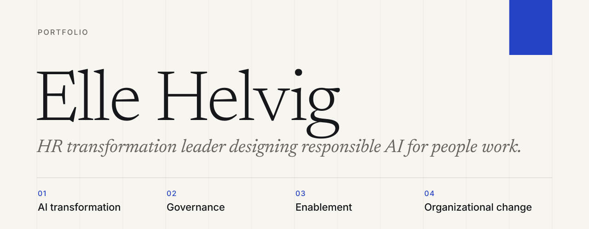
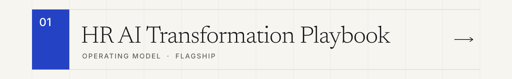
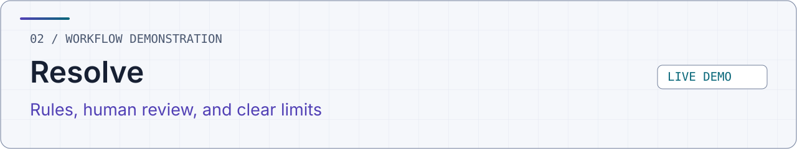
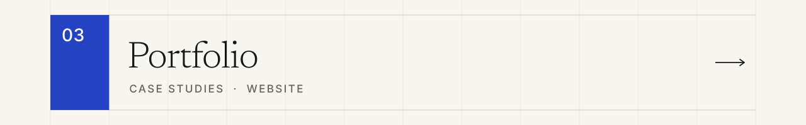

<picture>
  <source media="(max-width: 600px) and (prefers-color-scheme: dark)" srcset="assets/profile-mobile-dark.svg">
  <source media="(max-width: 600px)" srcset="assets/profile-mobile-light.svg">
  <source media="(prefers-color-scheme: dark)" srcset="assets/profile-dark.svg">
  
</picture>

  <a href="https://ellehelvig.github.io/">Portfolio</a> &nbsp;·&nbsp;
  <a href="https://www.linkedin.com/in/ellehelvig/">LinkedIn</a> &nbsp;·&nbsp;
  <a href="mailto:ellehelvig@gmail.com">Email</a>

 

I turn responsible AI principles into practical HR workflows, governance, evaluation, and adoption. The work below shows where AI can support people work, where it should stop, and what evidence a team needs before anything scales.

 

## Selected work

<a href="https://github.com/ellehelvig/hr-ai-transformation-playbook">
<picture>
  <source media="(max-width: 600px) and (prefers-color-scheme: dark)" srcset="assets/card-playbook-mobile-dark.svg">
  <source media="(max-width: 600px)" srcset="assets/card-playbook-mobile-light.svg">
  <source media="(prefers-color-scheme: dark)" srcset="assets/card-playbook-dark.svg">
  
</picture>
</a>

An operating model that takes HR leaders from AI opportunity through work redesign, governance, pilots, evaluation, and adoption.

<a href="https://github.com/ellehelvig/peopleops-resolution-agent">
<picture>
  <source media="(max-width: 600px) and (prefers-color-scheme: dark)" srcset="assets/card-resolve-mobile-dark.svg">
  <source media="(max-width: 600px)" srcset="assets/card-resolve-mobile-light.svg">
  <source media="(prefers-color-scheme: dark)" srcset="assets/card-resolve-dark.svg">
  
</picture>
</a>

A synthetic HR request workflow that shows where rules help, where a person must decide, and where the system stops. [Try the demo](https://ellehelvig.github.io/peopleops-resolution-agent/) · [Evidence and limits](https://github.com/ellehelvig/peopleops-resolution-agent/blob/main/docs/evaluation-results.md)

<a href="https://ellehelvig.github.io/">
<picture>
  <source media="(max-width: 600px) and (prefers-color-scheme: dark)" srcset="assets/card-portfolio-mobile-dark.svg">
  <source media="(max-width: 600px)" srcset="assets/card-portfolio-mobile-light.svg">
  <source media="(prefers-color-scheme: dark)" srcset="assets/card-portfolio-dark.svg">
  
</picture>
</a>

Case studies, design choices, and evidence for each project, in one place.

 

## What I work on

<table>
  <tr>
    <td width="50%"><strong>AI-enabled work redesign.</strong> Which tasks change, which stay human, and why.</td>
    <td width="50%"><strong>Responsible AI governance.</strong> Policy, risk review, and decision rights, settled before the build.</td>
  </tr>
  <tr>
    <td width="50%"><strong>HR transformation.</strong> Operating models and talent practices that hold up through change.</td>
    <td width="50%"><strong>AI adoption and enablement.</strong> Literacy, practice time, and the habits that make change stick.</td>
  </tr>
  <tr>
    <td colspan="2"><strong>Evaluation and human oversight.</strong> Evidence that a pilot worked, and a person accountable for each decision.</td>
  </tr>
</table>

 

## Stack and methods

Python · HTML / CSS · MCP tools · GitHub Actions · Synthetic-data evaluation · Human review

[Technical evidence: playbook](https://github.com/ellehelvig/hr-ai-transformation-playbook/blob/main/docs/evidence-index.md) · [Technical evidence: Resolve](https://github.com/ellehelvig/peopleops-resolution-agent/blob/main/TECHNICAL-WALKTHROUGH.md)

 

## Background

I'm an HR transformation and organizational change leader with a background in enterprise talent strategy, HR technology, organizational effectiveness, and workforce transformation. I've partnered with business and HR leaders to modernize talent practices, strengthen workforce capabilities, and lead complex change across global organizations.

Today, my focus is where AI, HR, and the future of work meet. I bring enterprise transformation experience to hands-on AI development, exploring how well-designed workflows, responsible governance, and thoughtful adoption can improve how organizations operate and how people work.

 

## Connect

[Portfolio](https://ellehelvig.github.io/) &nbsp;·&nbsp; [LinkedIn](https://www.linkedin.com/in/ellehelvig/) &nbsp;·&nbsp; [ellehelvig@gmail.com](mailto:ellehelvig@gmail.com)
