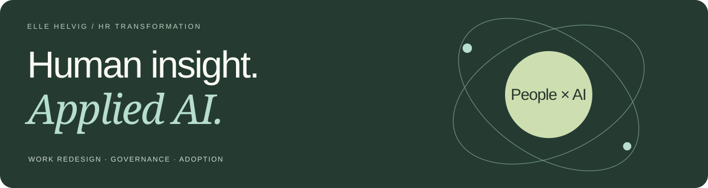

<picture>
  <source media="(max-width: 600px)" srcset="assets/profile-modern-mobile.svg">
  
</picture>

I'm an HR and talent strategist with 10+ years in enterprise technology, including Thomson Reuters, VMware, MongoDB, KPMG, and SAIC. I work on how people teams adopt AI: which work should change, who owns each decision, and how you know it helped. The projects below show that thinking in working form.

M.S. · SHRM-SCP · Open to talent, AI enablement, and HR transformation leadership roles

[LinkedIn](https://www.linkedin.com/in/ellehelvig/) · [Portfolio](https://ellehelvig.github.io/) · [Email](mailto:ellehelvig@gmail.com)

## Selected work

- **[People Leadership OS](https://github.com/ellehelvig/people-leadership-os):** how a Chief of Staff could run the Office of the CPO on GitHub. Issues are the intake, decision records are the memory, and Copilot drafts a weekly brief that a person edits. Start with the [weekly brief](https://github.com/ellehelvig/people-leadership-os/blob/main/briefs/2026-w46-cpo-brief.md).
- **[HR AI Transformation Playbook](https://github.com/ellehelvig/hr-ai-transformation-playbook):** a path from an AI idea to a governed pilot decision, covering use-case selection, work redesign, governance, enablement, and evaluation, with runnable synthetic examples. [Evidence and limits](https://github.com/ellehelvig/hr-ai-transformation-playbook/blob/main/docs/evidence-index.md).
- **[Resolve](https://github.com/ellehelvig/peopleops-resolution-agent):** a fictional HR request workflow that drafts answers from policy and pauses for human review. My tests showed keyword routing broke on paraphrased requests, so I published the failures and kept it on a production hold. [Try the demo](https://ellehelvig.github.io/peopleops-resolution-agent/) · [Case study](https://github.com/ellehelvig/peopleops-resolution-agent/blob/main/docs/case-study.md).
- **[Work Experiment Lab](https://elle-helvig-work-experiment-lab.lovable.app):** an interactive demo for choosing what to test, comparing a fictional three-arm pilot, and deciding what changes when speed improves but accuracy drops.

## What I bring

- Talent management and AI-enabled work redesign
- Learning, adoption, and change management
- HR operations with clear human accountability
- Evaluation and responsible AI governance

All projects are independent and use invented data. I built them with AI-assisted development; the HR problems, operating models, and decision rules are mine. None claims production readiness or measured business outcomes.

Content and rights

[MIT](LICENSE) covers original source code and verified original design contributions only. Personal biography, career history, portraits, and testimonials are **all rights reserved**. Personal content in `README.md`, `scripts/generate_brand_assets.py`, `assets/profile-dark.svg`, `assets/profile-light.svg`, `assets/profile-mobile-dark.svg`, and `assets/profile-mobile-light.svg` is excluded. [NOTICE](NOTICE) lists every excluded file path and third-party exception; the [asset-origin inventory](docs/asset-origin.md) records the checks. Review screenshots are outside MIT.

